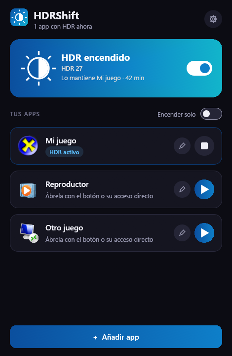
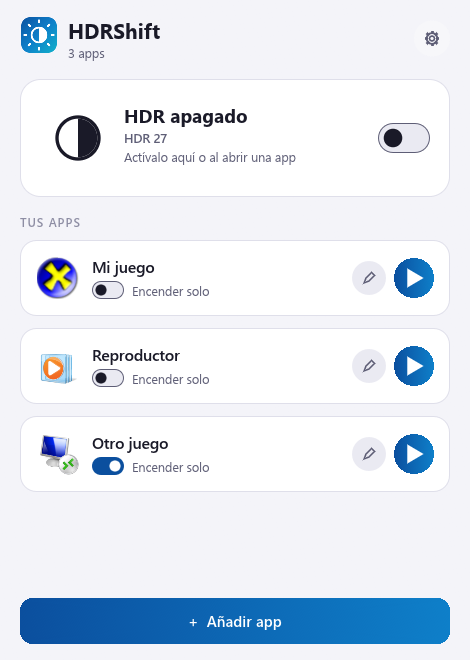

<div align="center">

# HDRShift

**HDR automático para cada app en Windows: se enciende al abrir un juego y vuelve como estaba al cerrarlo.**


[](https://ko-fi.com/yesidrobayo)

[English](README.md) · **Español** · [Cambios por versión](CHANGELOG.es.md)




</div>

> [!WARNING]
> **Proyecto personal, sin garantía.** Hice HDRShift para mi propio uso y lo comparto por si a alguien más le sirve. Se ofrece tal cual, y
> puede que no funcione con tu monitor.
>
> **Beta.** Se ha probado en un solo monitor (mira el [estado de las pruebas](#-estado-de-las-pruebas)).

El HDR de Windows es todo o nada: si lo dejas encendido, el escritorio y las apps SDR pueden verse lavados; si lo dejas
apagado, tienes que entrar en Configuración cada vez que juegas. HDRShift lo hace por ti. Apuntas tus juegos y
reproductores, los abres desde su acceso directo y el HDR se enciende justo antes de que arranquen. Al cerrarlos, el HDR
vuelve como estaba, y si ya estaba encendido, HDRShift no lo toca.

**Por defecto no queda nada en marcha.** Cuando ninguna app necesita HDR, no hay ningún proceso de HDRShift en tu PC.

## Contenido

- [Funciones](#-funciones)
- [Cómo funciona](#-cómo-funciona)
- [Cómo mantiene bien tu HDR](#%EF%B8%8F-cómo-mantiene-bien-tu-hdr)
- [Estado de las pruebas](#-estado-de-las-pruebas)
- [Instalar](#-instalar)
- [Cómo se usa](#-cómo-se-usa)
- [Ajustes](#%EF%B8%8F-ajustes)
- [Preguntas frecuentes](#-preguntas-frecuentes)
- [Tecnología](#-tecnología)
- [Desarrollo](#-desarrollo)
- [Créditos](#-créditos)
- [Apoya el proyecto](#-apoya-el-proyecto)
- [Licencia y contribuciones](#-licencia-y-contribuciones)

## ✨ Funciones

- **HDR por app:** eliges en qué monitores se enciende para cada juego o reproductor.
- **Accesos directos que funcionan donde los pongas:** cada app tiene su `.lnk` con su propio icono. Si renombras la app,
  el acceso sigue funcionando.
- **Entiende los lanzadores:** si un lanzador abre el juego y se cierra, el HDR sigue encendido mientras haya algo abierto
  de esa carpeta.
- **Varias apps a la vez:** el HDR sigue encendido hasta que se cierra la última.
- **Interruptor manual:** enciende el HDR hasta que tú digas, desde la ventana, la bandeja o un acceso directo de un clic.
- **Detección automática opcional, por app:** enciende el HDR aunque la abra otro lanzador. Viene apagada.
- **Fácil de añadir:** elige una app que ya esté abierta, sin tener que buscar su exe.
- **No se le olvida:** tras un cuelgue, un apagón o un monitor desconectado, deja el HDR como estaba en cuanto puede.
- **Tema oscuro y claro**, o el mismo de Windows. **Español e inglés.**
- **Portable y ligero:** un solo exe de unos 5 MB, sin instalador ni runtime.

## 🔍 Cómo funciona

1. Abres el acceso directo. HDRShift enciende el HDR en los monitores de esa app, comprueba que Windows lo cambió de verdad y
   te lo confirma con un aviso de Windows.
2. Espera un momento a que el monitor cambie de señal, porque muchos juegos solo miran el HDR al arrancar, y abre la app.
3. Se queda en la bandeja mientras la app está abierta, con unos 4 MB de memoria.
4. Al cerrarse la app espera unos 5 segundos, por si un lanzador está pasando el relevo al juego, deja el HDR como estaba y
   se cierra.

## 🛡️ Cómo mantiene bien tu HDR

Lo difícil de este tipo de programas no es encender el HDR, sino no dejarlo nunca mal. HDRShift sigue cuatro reglas:

- **Un solo dueño.** Solo un proceso puede cambiar el HDR. Los demás accesos directos le pasan su orden y salen, así que dos
  sesiones no pueden pisarse.
- **Primero la deuda.** Antes de encender el HDR, apunta que tiene que apagarlo. Si el proceso muere justo ahí, la siguiente
  ejecución sabe qué hacer.
- **Solo cree lo que lee.** Un cambio solo cuenta tras leer el estado real. Windows puede responder "acceso denegado" con la
  pantalla apagada y aplicar el cambio igualmente, o al revés.
- **La deuda solo se borra cuando se paga.** Si no puede dejar el HDR como estaba, lo sigue intentando: cuando vuelve el
  monitor, cada 30 segundos y en el siguiente inicio de sesión de Windows.

Solo cambia el mismo ajuste de HDR que cambiarías en Configuración de Windows. No le envía nada a tu monitor por su cuenta y
no toca la gestión automática de color.

## 🧪 Estado de las pruebas

| Probado | Resultado |
|---|---|
| ASUS XG27AQDMES, Windows 11 build 26300 | ✅ Funciona |
| Abrir y cerrar una app, HDR restaurado idéntico | ✅ Prueba real |
| Dos apps a la vez, el mismo acceso dos veces | ✅ Prueba real |
| Lanzador que abre el juego y se cierra | ✅ Prueba real |
| Un juego real, con su acceso directo y con **Encender solo** | ✅ Prueba real |
| Proceso matado, recuperación al iniciar sesión | ✅ Prueba real |
| Reiniciar el PC con una app abierta, arrancar con Windows | ✅ Prueba real |
| Pantalla apagada | ✅ Prueba real |
| Detección automática | ✅ Prueba real |

| Aún sin probar | |
|---|---|
| Windows 10 y Windows 11 anterior a 24H2 | Usa la petición antigua de Windows; debería funcionar, sin comprobar |
| Varios monitores a la vez, dos monitores iguales | Solo pruebas automáticas |
| Escala superior al 100 % en una pantalla real | Simulada al 150 % |
| Juegos con antitrampas | Funcionó en una sesión de un juego; otros podrían ocultar su proceso a la detección |

Medido en un PC: unos 0,3 s en cambiar el HDR; 3,6 MB de memoria privada y 0,03 % de CPU con una app abierta; 2,1 MB y
0,1 % de CPU en la bandeja esperando una app con **Encender solo**, que nota en medio segundo. La ventana usa unos 85 MB, solo mientras está abierta.

## 📦 Instalar

1. Descarga `HDRShift.exe` desde [Releases](https://github.com/Yesid-Robayo/HDRShift/releases).
2. *(Recomendado)* Comprueba que es el archivo oficial. En PowerShell:
   ```powershell
   Get-FileHash .\HDRShift.exe -Algorithm SHA256
   ```
   Debe coincidir con el `SHA256SUMS.txt` de la versión. Cada versión la compila GitHub Actions desde el código de este
   repositorio y lleva una [atestación de origen](https://docs.github.com/actions/security-for-github-actions/using-artifact-attestations)
   que puedes verificar con `gh attestation verify HDRShift.exe --repo Yesid-Robayo/HDRShift`.
3. Ponlo en la carpeta que quieras y ábrelo. No tiene instalador.

> [!NOTE]
> El exe no está firmado con un certificado de pago, así que Windows SmartScreen puede avisarte la primera vez. Elige **Más
> información → Ejecutar de todas formas** si el SHA256 coincide.

Los accesos directos apuntan al exe: déjalo en el mismo sitio una vez creados.

Para desinstalar: en los ajustes, pulsa **Desinstalar…**, elige si conservas tus datos y borra el exe.

## 🎮 Cómo se usa

1. Abre HDRShift. La tarjeta de arriba muestra si tu monitor tiene el HDR encendido, con un interruptor para cambiarlo a mano.
2. Pulsa **Añadir app**, elige el exe del juego o búscalo en **Elegir de las apps abiertas**, y pulsa **Guardar**. Tus
   monitores con HDR ya vienen marcados.
3. Pulsa el lápiz de la app y luego **Crear acceso directo**.
4. A partir de ahora, abre tu juego desde ese acceso directo.

El botón de reproducir de cada tarjeta hace lo mismo. Con una sesión activa se convierte en un botón de parar, que termina la
sesión y deja el HDR como estaba sin cerrar la app.

¿Prefieres olvidarte? Activa **Encender solo** en la tarjeta de una app: el HDR se enciende la abras como la abras.
Mientras alguna app lo tenga activo, HDRShift arranca con Windows y se queda en la bandeja.

> [!IMPORTANT]
> El botón de reproducir y el acceso directo encienden el HDR **antes** de abrir el juego. **Encender solo**
> solo puede hacerlo **después**, porque el juego lo abre otro programa: HDRShift lo nota en medio segundo. Si un juego necesita
> el HDR antes de arrancar, usa una de esas dos, o enciende el interruptor manual antes de abrirlo.

Para cambiar una app o quitarla, pulsa su lápiz.

Para cerrar HDRShift por completo: **Salir** en el menú de la bandeja, o **Cerrar HDRShift por completo** en los ajustes. Antes
deja el HDR como estaba.

## ⚙️ Ajustes

| Ajuste | Qué hace |
|---|---|
| **Tema** | Como Windows, oscuro o claro. |
| **Idioma** | Español o inglés. |
| **Quedarse en la bandeja** | Deja el interruptor a mano. Apagado, HDRShift no deja nada en marcha sin apps abiertas, salvo que una tenga **Encender solo** o actives **Iniciar con Windows**. |
| **Iniciar con Windows** | Arranca en la bandeja. También ocurre si una app tiene **Encender solo**. |
| **Crear acceso directo del interruptor** | Crea un acceso que enciende o apaga el HDR de un clic. |

En una app, **Opciones avanzadas** tiene sus argumentos, otro proceso que cuenta como la app, para los lanzadores que abren el
juego desde otra carpeta y la espera antes de abrirla. Sube la espera si el juego se abre antes de que tu
monitor termine de cambiar.

Tus datos están en `%APPDATA%\HDRShift`: `config.json` (apps y ajustes), `ledger.json` (lo que queda por restaurar),
`status.json` (lo que muestra la ventana) y `hdrshift.log`.

## ❓ Preguntas frecuentes

**¿Es seguro?**
HDRShift no usa internet, no pide administrador y no instala drivers ni servicios. Solo cambia el ajuste de HDR de Windows y
guarda sus datos en tu carpeta de usuario. En [SECURITY.md](SECURITY.md) está lo que hace y lo que no hace.

**¿Esto puede dañar mi monitor?**
No. HDRShift solo cambia el ajuste de HDR de Windows, el mismo interruptor de Configuración o `Win + Alt + B`.

**¿Me pueden banear en juegos online?**
El riesgo es muy bajo, porque HDRShift no toca el juego: no inyecta nada, no lee su memoria ni cambia sus archivos. Solo cambia
el ajuste de HDR de Windows y consulta los procesos y sus rutas, como el Administrador de tareas. Los antitrampas no publican
sus reglas, así que nadie puede prometer el 100 %, y lo usas bajo tu propio riesgo. En juegos con antitrampas, deja que los abra
su lanzador y usa **Encender solo** o el interruptor manual: el botón de abrir y los accesos directos hacen que sea
HDRShift quien los abra.

**Mi juego no detecta el HDR.**
Muchos juegos lo deciden al arrancar. Usa el botón de reproducir o el acceso directo, que encienden el HDR
primero. Si aun así falla, sube la espera en **Opciones avanzadas**: quizá tu monitor necesite más tiempo. Con **Encender solo**,
el juego ya está arrancando cuando se enciende: reinícialo una vez.

**No sé dónde está el exe del juego.**
Abre el juego y luego pulsa **Añadir app** y **Elegir de las apps abiertas**.

**El HDR se apaga con el juego abierto.**
Seguramente su lanzador lo abrió desde otra carpeta. En la app, entra en **Opciones avanzadas** y escribe el nombre del
proceso del juego, por ejemplo `game.exe`.

**El HDR se quedó encendido.**
Abre HDRShift: termina lo que hubiera quedado pendiente. Si aparece la tarjeta **HDR por restaurar**, Windows todavía no le
deja; lo seguirá intentando solo. El motivo está en `hdrshift.log`. Si ese monitor ya no existe, pulsa **Olvidar**.
También puedes apagar el HDR a mano con `Win + Alt + B` o en **Configuración › Pantalla**.

**¿Es portable?**
Sí. En los ajustes, pulsa **Guardar los datos junto al exe (portable)**: tus datos pasan a una carpeta `HDRShiftData` junto al
exe. Tus accesos directos siguen necesitando que el exe se quede donde está.

**Configuración muestra otro brillo.**
Es el brillo del contenido SDR dentro del HDR, un ajuste de Windows. HDRShift no lo cambia.

**Windows SmartScreen o mi antivirus me avisan.**
El exe no está firmado con un certificado de pago, así que es normal en un programa poco conocido. Comprueba su SHA256 o su
atestación.

## 🔧 Tecnología

- **Rust**, un solo exe sin runtime. El servicio usa la API de Windows directamente; la ventana usa
  [egui](https://github.com/emilk/egui) y es un proceso aparte que solo existe mientras está abierta.
- La API CCD de Windows para el HDR: `SET_HDR_STATE` en Windows 11 24H2 o posterior, `SET_ADVANCED_COLOR_STATE` antes.
- Iconos dibujados por código: el del exe se genera al compilar.

El diseño se explica en [docs/architecture.md](docs/architecture.md).

## 💻 Desarrollo

Requisitos: [Rust](https://rustup.rs) (estable, `x86_64-pc-windows-msvc`) y las Visual Studio Build Tools (C++).

```powershell
cargo run -p hdrshift                          # ventana (depuración)
cargo test                                     # pruebas: ninguna toca tu pantalla
cargo clippy --all-targets -- -D warnings      # lint
cargo build --release                          # target\release\HDRShift.exe
```

`HDRSHIFT_DATA_DIR` cambia la carpeta de datos (útil para probar sin tocar tu configuración real). En compilaciones de
depuración, `HDRSHIFT_DEMO` (`on`, `off`, `edit`, `settings`, `welcome`) abre una pantalla con datos de ejemplo, y
`HDRSHIFT_DEMO_SHOT` guarda una captura en un `.bmp`.

## 🙏 Créditos

- **[egui / eframe](https://github.com/emilk/egui)** (MIT o Apache-2.0), **[windows-sys](https://github.com/microsoft/windows-rs)**
  (MIT o Apache-2.0), **[serde](https://serde.rs)** (MIT o Apache-2.0) y el resto de crates de
  [THIRD_PARTY_NOTICES.txt](THIRD_PARTY_NOTICES.txt).
- **HDRShift es un proyecto independiente**, sin relación con Microsoft, ASUS ni ninguna otra marca, ni respaldado por ellas.
  Sus nombres pertenecen a sus dueños.
- **Uso de IA:** esta app se desarrolló con ayuda de herramientas de IA.

## ☕ Apoya el proyecto

HDRShift es gratis y lo hace una sola persona. Si te gusta y quieres apoyarlo, puedes invitarme a un café en
**[Ko-fi](https://ko-fi.com/yesidrobayo)**. No es obligatorio: contar si funciona con tu monitor también ayuda mucho.

---

## 📄 Licencia y contribuciones

- HDRShift tiene licencia **[MIT](LICENSE)**. Se ofrece **tal cual, sin ninguna garantía**.
- Es un proyecto personal, hecho para uso propio de su autor y compartido por si le sirve a alguien más: no hay compromiso de
  soporte y los *issues* se responden cuando hay tiempo.
- **No se aceptan *pull requests*** (se cierran automáticamente). Los errores, las ideas y los informes de monitores van en un
  *issue*; mira [CONTRIBUTING.md](CONTRIBUTING.md).
- Los problemas de seguridad se avisan en privado: [SECURITY.md](SECURITY.md).
