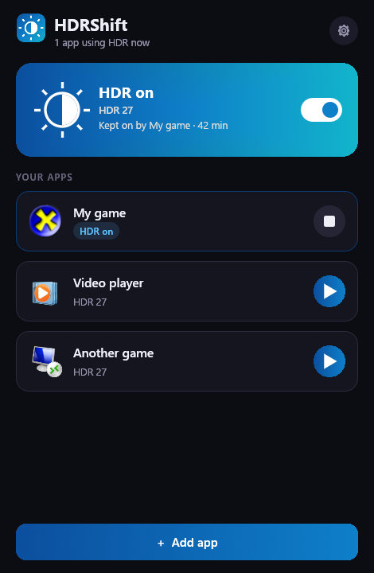
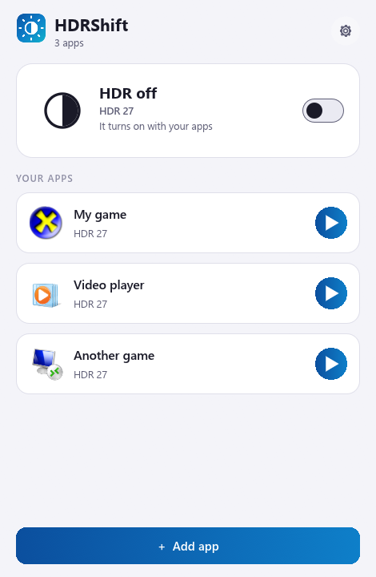

<div align="center">

# HDRShift

**Automatic HDR for each app on Windows: it turns on when you open a game and goes back to how it was when you close it.**


**English** · [Español](README.es.md) · [Changelog](CHANGELOG.md)




</div>

> [!WARNING]
> **Personal project: use it at your own risk.** HDRShift was made for its author's own use and is shared as is, with no
> warranty. It may not work with your monitor, and any problem that comes from using it is your responsibility.
>
> **Beta.** It has been tested on a single monitor (see the [test status](#-test-status)).

Windows HDR is all or nothing: left on, your desktop and SDR apps can look washed out; left off, you have to go into
Settings every time you play. HDRShift does it for you. You list your games and players, open them from their shortcut,
and HDR turns on just before they start. When you close them, HDR goes back to how it was, and if it was already on,
HDRShift doesn't touch it.

**Nothing stays running by default.** When no app needs HDR, there is no HDRShift process on your PC.

## Contents

- [Features](#-features)
- [How it works](#-how-it-works)
- [How it keeps your HDR right](#%EF%B8%8F-how-it-keeps-your-hdr-right)
- [Test status](#-test-status)
- [Install](#-install)
- [How to use it](#-how-to-use-it)
- [Settings](#%EF%B8%8F-settings)
- [FAQ](#-faq)
- [Technology](#-technology)
- [Development](#-development)
- [Credits](#-credits)
- [License and contributions](#-license-and-contributions)

## ✨ Features

- **HDR per app:** choose which monitors get HDR for each game or player.
- **Shortcuts that work anywhere:** each app gets its own `.lnk` with the app's icon. Rename the app and the shortcut
  keeps working.
- **Launchers are understood:** if a launcher opens the game and closes, HDR stays on while anything from that folder
  is running.
- **Several apps at once:** HDR stays on until the last one closes.
- **Manual switch:** turn HDR on until you say otherwise, from the window, the tray or a one-click shortcut.
- **Optional automatic detection:** turns HDR on even if you open the app from Steam or another launcher. Off by default.
- **It never forgets:** after a crash, a power cut or a monitor being unplugged, HDR is put back when possible.
- **Dark and light themes**, or the same one as Windows. **Spanish and English.**
- **Portable and light:** one exe of about 5 MB, with no installer or runtime.

## 🔍 How it works

1. You open the shortcut. HDRShift turns on HDR in that app's monitors and checks that Windows really changed it.
2. It waits a moment for the monitor to switch signal, since many games read HDR only when they start, and opens the app.
3. It stays in the tray while the app is open, using about 4 MB of memory.
4. When the app closes, it waits about 5 seconds, in case a launcher is handing over to the game, puts HDR back and exits.

## 🛡️ How it keeps your HDR right

The hard part of this kind of tool isn't turning HDR on, but never leaving it wrong. HDRShift follows four rules:

- **One owner.** Only one process can change HDR. Other shortcuts hand it their order and exit, so two sessions can't
  overwrite each other.
- **Debt first.** Before turning HDR on, it writes down that it has to turn it off. If the process dies right there,
  the next run knows what to do.
- **It only believes what it reads.** A change counts only after reading the real state back. Windows can answer
  "access denied" with the screen off and still apply the change, or the other way around.
- **The debt is only cleared when it's paid.** If HDR can't be put back, it keeps trying: when the monitor returns, every
  30 seconds, and at the next Windows sign-in.

It only changes the same HDR setting you'd change in Windows Settings. It doesn't send anything to your monitor by itself,
and it doesn't touch Automatic Color Management.

## 🧪 Test status

| Tested | Result |
|---|---|
| ASUS XG27AQDMES, Windows 11 build 26300 | ✅ Works |
| Open and close an app, HDR restored identically | ✅ Real test |
| Two apps at once, same shortcut twice | ✅ Real test |
| Launcher that opens the game and exits | ✅ Real test |
| Process killed, sign-in recovery, Windows sign-out with an app open | ✅ Real test (sign-out simulated) |
| Screen off | ✅ Real test |
| Automatic detection | ✅ Real test |

| Not tested yet | |
|---|---|
| Windows 10 and Windows 11 before 24H2 | Uses the older Windows request; should work, not verified |
| Several monitors at once, two identical monitors | Covered by automated tests only |
| Display scale above 100 % | |
| Anti-cheat games | They might hide their process from detection |

Measured on one PC: about 0.3 s to change HDR; 3.6 MB of private memory and 0.03 % CPU with an app open; 2.1 MB and 0.02 %
CPU in the tray with detection on. The window uses about 75 MB, only while it's open.

## 📦 Install

1. Download `HDRShift.exe` from [Releases](https://github.com/Yesid-Robayo/HDRShift/releases).
2. *(Recommended)* Check that it's the official file. In PowerShell:
   ```powershell
   Get-FileHash .\HDRShift.exe -Algorithm SHA256
   ```
   It must match the `SHA256SUMS.txt` of the release. Every release is built by GitHub Actions from this repository's
   code and carries a [provenance attestation](https://docs.github.com/actions/security-for-github-actions/using-artifact-attestations)
   that you can verify with `gh attestation verify HDRShift.exe --repo Yesid-Robayo/HDRShift`.
3. Put it in a folder of your choice and open it. There is no installer.

> [!NOTE]
> The exe is not signed with a paid certificate, so Windows SmartScreen may warn you the first time. Choose **More
> info → Run anyway** if the SHA256 matches.

Shortcuts point to the exe, so keep it in the same place once you've created them.

To uninstall: in the settings, press **Uninstall…**, choose whether to keep your data, and delete the exe.

## 🎮 How to use it

1. Open HDRShift. The top card shows whether your monitor has HDR on, with a switch to change it by hand.
2. Press **Add app**, choose the game's exe and press **Save**. Your HDR monitors are selected already.
3. Click the app's card and press **Create shortcut**.
4. Open your game from that shortcut from now on.

The play button in each card does the same thing. While a session is active it turns into a stop button, which ends the
session and puts HDR back without closing the app.

To close HDRShift completely: **Quit** in the tray menu, or **Quit HDRShift completely** in the settings. HDR goes back to how
it was first.

## ⚙️ Settings

| Setting | What it does |
|---|---|
| **Theme** | Same as Windows, dark or light. |
| **Language** | Spanish or English. |
| **Stay in the tray** | Keeps the switch at hand. Off, HDRShift leaves nothing running when no apps are open. |
| **Detect my apps on its own** | Turns HDR on when one of your apps opens by any route. Needs **Stay in the tray**. |
| **Start with Windows** | Starts in the tray. Needs **Stay in the tray**. |
| **Create the switch shortcut** | Creates a shortcut that turns HDR on or off with one click. |

In an app, **Advanced options** has its arguments and another process that counts as the app, for launchers that open the
game from a different folder.

Your data is in `%APPDATA%\HDRShift`: `config.json` (apps and settings), `ledger.json` (what's left to restore),
`status.json` (what the window shows) and `hdrshift.log`.

## ❓ FAQ

**Can this damage my monitor?**
No. HDRShift only changes the Windows HDR setting, the same as the switch in Settings or `Win + Alt + B`.

**My game doesn't see HDR.**
Many games decide when they start. Use the shortcut, which turns HDR on first. With automatic detection, the game may
already be starting when HDR turns on: restart it once.

**HDR turns off while the game is still open.**
Its launcher probably opened it from another folder. In the app, go to **Advanced options** and write the name of the
game's process, such as `game.exe`.

**HDR stayed on.**
Open HDRShift: it finishes anything left to restore. If the **HDR left to restore** card appears, Windows isn't letting it
yet; it keeps trying on its own. The reason is in `hdrshift.log`. If that monitor no longer exists, press **Forget**.

**Is it portable?**
Yes. In the settings, press **Keep the data next to the exe (portable)**: your data moves to a `HDRShiftData` folder beside
the exe. Your shortcuts still need the exe to stay where it is.

**The Settings page shows a different brightness.**
That's Windows' SDR brightness inside HDR. HDRShift doesn't change it.

**Windows SmartScreen or my antivirus warns me.**
The exe isn't signed with a paid certificate, so it's normal for a little-known program. Check its SHA256 or attestation.

## 🔧 Technology

- **Rust**, a single exe with no runtime. The service uses the Windows API directly; the window uses
  [egui](https://github.com/emilk/egui) and is a separate process that only exists while it's open.
- The Windows CCD API for HDR: `SET_HDR_STATE` on Windows 11 24H2 or later, `SET_ADVANCED_COLOR_STATE` before that.
- Icons drawn in code: the exe icon is generated at build time.

The design is explained in [docs/architecture.md](docs/architecture.md).

## 💻 Development

Requirements: [Rust](https://rustup.rs) (stable, `x86_64-pc-windows-msvc`) and the Visual Studio Build Tools (C++).

```powershell
cargo run -p hdrshift                          # window (debug)
cargo test                                     # tests: none of them touch your screen
cargo clippy --all-targets -- -D warnings      # lint
cargo build --release                          # target\release\HDRShift.exe
```

`HDRSHIFT_DATA_DIR` changes the data folder (handy for trying things without touching your real configuration). In debug
builds, `HDRSHIFT_DEMO` (`on`, `off`, `edit`, `settings`, `welcome`) opens a screen with sample data, and
`HDRSHIFT_DEMO_SHOT` saves a capture of it as a `.bmp`.

## 🙏 Credits

- **[egui / eframe](https://github.com/emilk/egui)** (MIT or Apache-2.0), **[windows-sys](https://github.com/microsoft/windows-rs)**
  (MIT or Apache-2.0), **[serde](https://serde.rs)** (MIT or Apache-2.0) and the rest of the crates listed in
  [THIRD_PARTY_NOTICES.txt](THIRD_PARTY_NOTICES.txt).
- **HDRShift is an independent project**, not affiliated with or endorsed by Microsoft, ASUS or any other brand. Their
  names belong to their owners.
- **AI disclosure:** this app was developed with the help of AI tools.

---

## 📄 License and contributions

- HDRShift is licensed under the **[MIT License](LICENSE)**. It is provided **as is, without any warranty**, and you use
  it **at your own risk**.
- It's a personal project, made for its author's own use and shared in case it's useful to someone else: there's no
  support commitment, and *issues* get an answer when there's time.
- **Pull requests are not accepted** (they are closed automatically). Bugs, ideas and monitor reports go in an *issue*;
  see [CONTRIBUTING.md](CONTRIBUTING.md).
- Security problems are reported privately: [SECURITY.md](SECURITY.md).
